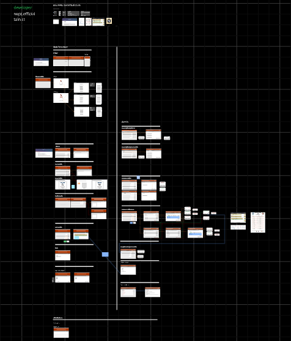

# KKU Open Shooting Club

A team-developed web application prototype for KKU Open Shooting Club, designed to publish competition announcements, manage registrations, and display results. Development was completed, but the application was never used in actual club operations.

This repository is preserved for portfolio purposes with the original repository owner's permission. It retains the original Git history and contributor attribution.

## My contributions — tainnnn

- Designed the UX/UI and created early design prototypes in Miro.
- Established the initial frontend application structure.
- Implemented authentication flows integrated with Supabase.

These describe my contributions within a collaborative project, rather than sole authorship of the entire application.

## UX/UI design

An overview of the design board. Open the Miro link below to zoom in and inspect individual screens and flows.

[View the original design board in Miro (view only)](https://miro.com/app/board/uXjVJ8vCM9w=/?share_link_id=319191507235)

The board documents early interface exploration and proposed user flows. The designs represent work in progress and may differ from the implemented screens.

## Technology

Next.js 15 · React 19 · TypeScript · Tailwind CSS · Supabase

## Project status

- Development completed; never used in actual club operations.
- Authentication is currently unavailable because Supabase has stopped serving the original backend project.
- An existing Vercel deployment is available, but it is not a functional demo: authentication and backend-dependent content are unavailable because the original Supabase backend is no longer serving the project. The deployed site may therefore show little or no content. See the Miro board above for the design overview.

[Open existing deployment (limited functionality)](https://kku-games-shooting-club.vercel.app/)

## Contributors and origin

- [wangrinnakrub](https://github.com/wangrinnakrub)
- [tainnnn](https://github.com/tainnnn)

Original repository: [wangrinnakrub/KKU-OPEN-SHOOTING-CLUB](https://github.com/wangrinnakrub/KKU-OPEN-SHOOTING-CLUB) (private; access required).

Original README credits: nept.official · tain.ct

